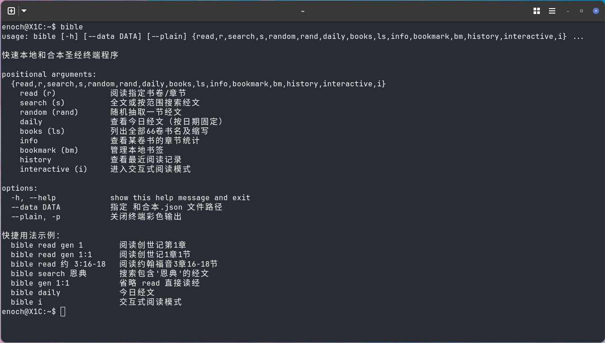
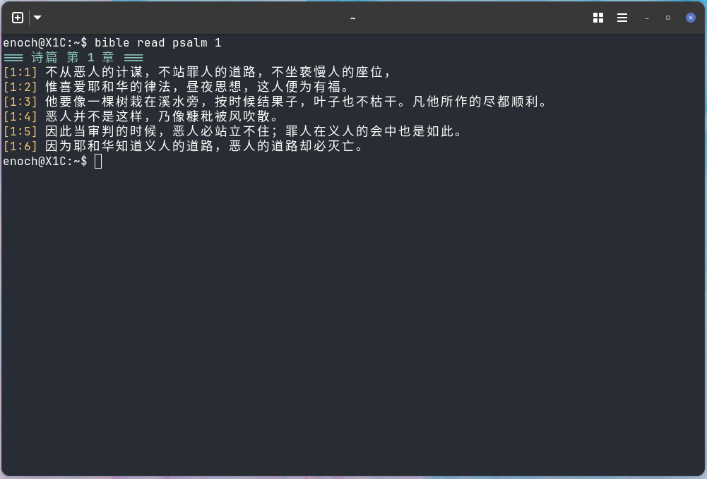
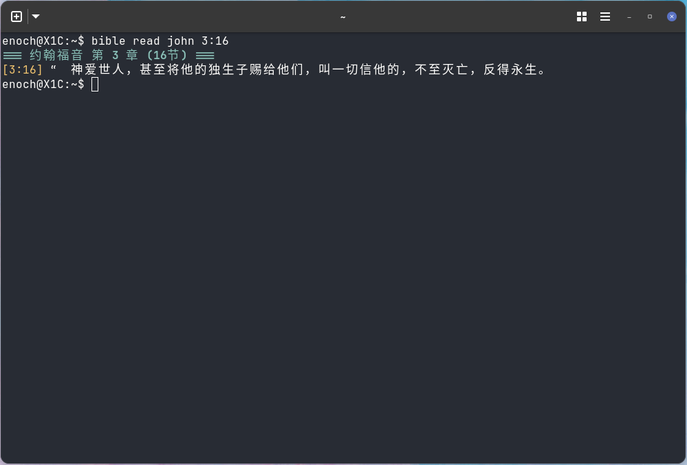
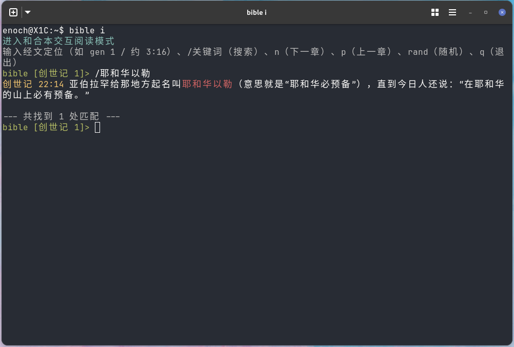
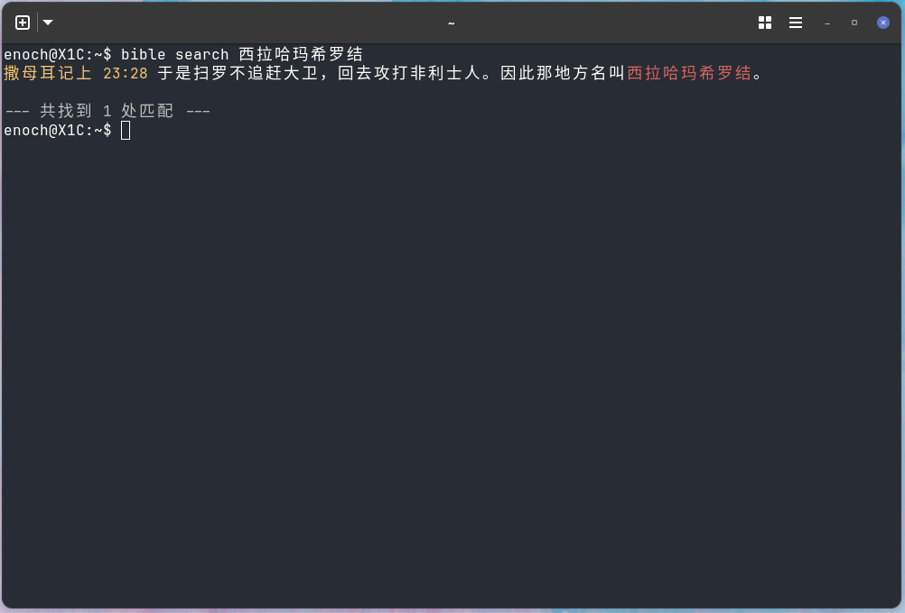

昨晚有点气。  

昨天晚上突然有个想法，就用 AI 付诸实践，完事后，本想发个朋友圈纪念一下，却发现我这条朋友圈被平台屏蔽了——好友根本看不到。我猜测可能是文字内容有敏感词吧，我就用英文代替（敏感词），发出去后，结果还是看不到。于是我将五张图片删掉一张（对平台来说可能最敏感的），发出去后，还是看不到；我再删一张吧，结果依然如此。折腾许久之后，我放弃了。  

平台对于言论审查太滥用了，虽然早就知道当前的环境就是这样，但是经历之后还是有些气愤的，以后都不是很想发朋友圈了。以下复现昨晚分享的内容：  

---

我当前使用的操作系统是Linux  Mint。  

一直在寻找好用的圣经软件，之前制作了一个极简[在线圣经](/bible/)，使用体验还是挺好的。因为它是网页，所以可以跨平台使用。当手头上没有圣经，或者设备上没有圣经软件时，打开网页就可以读圣经，还是不错的。  

只不过它也有缺点，第一是，它是在线网页，因此必须联网。第二，没有给它设计搜索功能。有时候我想不起一节经文具体在哪里的时候，还是得掏出手机的圣经软件才能搜索。这样效率还是挺慢的。  

昨晚灵光一现：我为什么不可以弄一个终端圣经程序呢？只要敲几个字，就可以阅读，也可以检索，不是挺好的吗？说干就干。我首先问ChatGPT，将我的需求用笼统的语言告诉它，让它总结我的需求，并让它为我扩展我可能还没想到的点，之后让它帮我写一份给 AI 用的提示词（Prompt）。之后我将“精读圣经”里的.db文件导出，交给Gemini，让其转成JSON格式。最后让Gemini 为我写了一个Python程序。其中稍微有过一点修改吧，结束后直接下载，用终端执行 ```bash install.sh``` ，它就安装成功了。

我试了一下，体验感觉非常好。打开终端输入 ```bible read xx``` 就可以直接阅读某一章圣经的内容，输入 ```bible search xx``` 就可以按关键字搜索。其他的，AI 还提供了一些别的功能，不过我还用不上，也不想再修改了，就这样吧。  

  

  

  

  

  