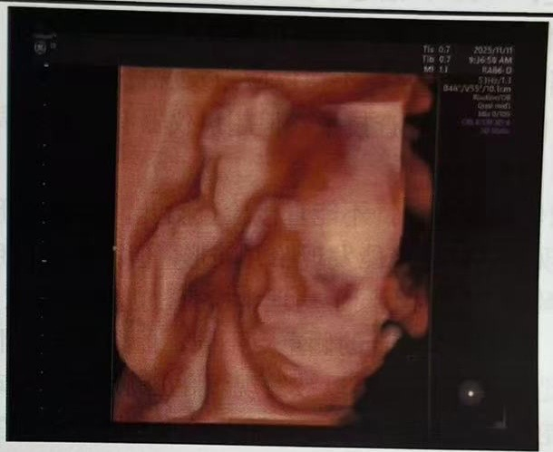
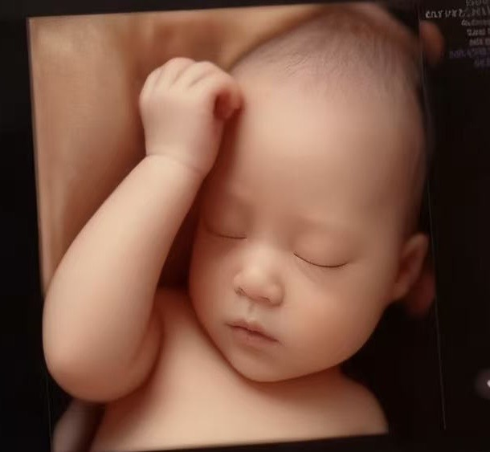
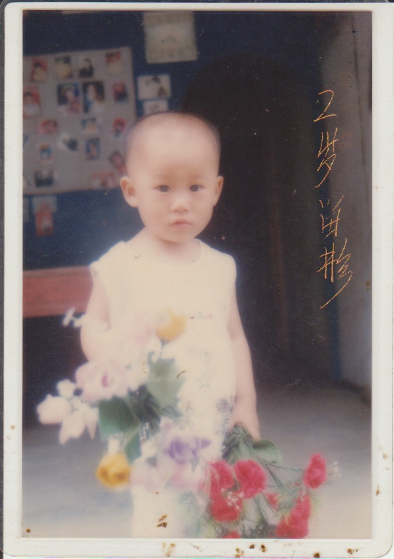

前几天，振丽去医院做了四维超声。小宝宝不是很配合，多次检查都没有找到最佳体位。医生让她在外面走走，让小宝宝翻个身。振丽在医院来回溜达了好几次，直到上午 11:15 才总算拍完。

根据检查结果，小宝宝的生长数据比正常略小大约一周，可能是营养吸收不太够。不过振丽说自己的体重已经涨了不少，看样子还是得再多吃一点。

这大概可以算是小宝宝的第一张“正面照”了。振丽说他看起来更像我，但我其实看不太出来。我觉得这个时期的宝宝五官本来就不明显，加上超声图像本身也比较模糊。

于是振丽试着用 AI 对图像进行了一下美化，得到了下面这张：

虽然 AI 还原的效果不算真实，但这么一看，小宝宝似乎还是挺眉清目秀的。和他爹多少有点相像：

🤣🤣🤣
